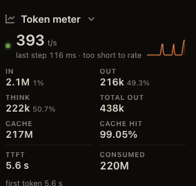
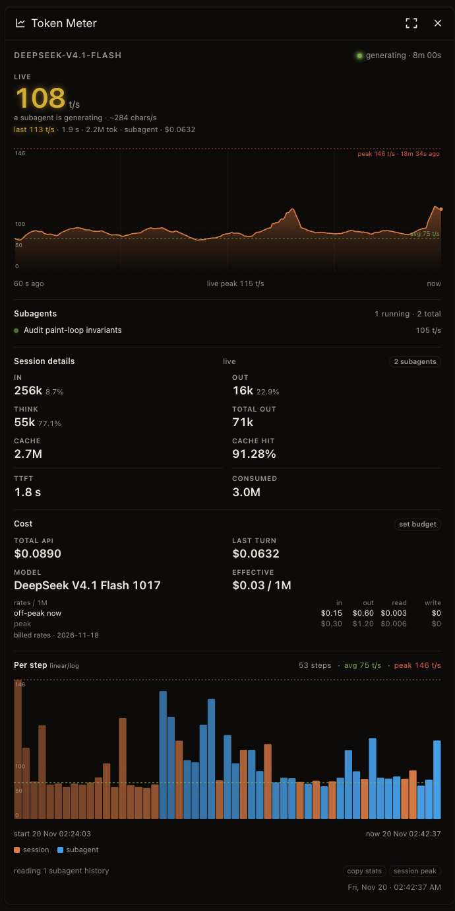

# Token Meter

Live tokens per second for the open OpenChamber session, and what that session
has spent: input, output, thinking, cache hits, time to first token, and the
total consumed. A session's subagents are part of it: while one of them streams,
the headline moves, and their tokens count in the totals.



The chat's Work Status panel keeps the speed beside the conversation.



The rail panel: live speed, running subagents, session totals, cost, and every
kept step with its count and time axis.

## Install

Settings → Extensions → paste this, choose **Add**, allow the two permissions
(a local service, read from OpenCode):

```
https://github.com/omkardamame/openchamber-token-meter.git
```

## What it shows

- **Live `t/s`** — the sum of the session and every streaming subagent, coloured
  by speed tier (matte red, green, blue, golden, violet); the last measured step sits
  underneath in the same tier colours.
- **Graph** — the last 60 seconds. The plot is scaled to the session's peak
  step, so the red `peak` line is the ceiling and carries the age of the step
  that set it; the green `avg` line sits below. Above both is the live estimate.
- **Subagents** — each subagent still working, its own live rate, and how many
  of the tree are running.
- **Totals** — In, Out, Think, Total out, Cache, Cache hit, TTFT, Consumed.
- **Cost** — the session's **API value**: what its tokens would cost at the
  model's published list rates, for the session and its subagents. The recorded
  charge sits beside it as `billed`, which is `$0` on a subscription. The model's
  own four rates (in, out, cache read, cache write) and where they came from are
  written underneath; a time-tiered model shows both sides with the active one
  first. The last turn's value also sits at the end of the last measured step's
  line.
- **Per step** — the session's step count and its last 1,000 steps, with a
  start/now time axis, orange for the session and blue for a subagent, the green
  average and the red best step.
- **Work Status** — the same speed and totals as a compact strip in the chat
  panel, so the speed sits next to the conversation.

## API value, and what is billed

Most OpenCode users are on a subscription or a plan, and OpenCode records
`cost: 0` for those sessions. A meter that shows the recorded cost therefore
shows `$0.0000` for a Claude or ChatGPT plan that is doing real work. **API
value** answers the other question: what would these tokens cost at the model's
published list price? It is a counterfactual, and it is never called spend — the
recorded charge stays visible as `billed`.

Prices come from a committed snapshot, `shared/price-book.js`, generated from
[models.dev](https://models.dev) (MIT) by `scripts/sync-prices.mjs` and covering
Anthropic, OpenAI, OpenCode Go, Command Code, OpenCode Zen and DeepSeek. The
service makes **no pricing request at runtime**: a price change arrives with a
release, and the source line under the rates carries the snapshot's date.

A model is matched in this order, and the exact match is recorded:

| Match | Meaning |
|---|---|
| `exact` | the provider and model id are in the book (a case difference still counts) |
| `alias` | a short name the vendor's own client uses, such as `opus` or `haiku` |
| `bare` | the id without its first path segment (`deepseek/deepseek-v4.1-flash`) |
| `family` | a known family name, resolved to its newest release |
| `lab` | a Command Code model priced from the lab that makes it |
| `override` | a rate you wrote into `price-overrides.json` |

An unknown model shows `no published rate`. The meter does not borrow a
neighbour's price, and a partially priced tree is prefixed `≥`, because the rest
of it has no published rate.

Context tiers apply per step, so the same session can price its large requests
at the higher band; time-of-day tariffs apply per step's own timestamp.

**Reconciliation.** For a metered provider, API value is compared with what
OpenCode recorded, per model. More than 1% apart shows a `price drift` flag and
the tooltip names both numbers. That check is what keeps the snapshot honest:
across 1,805 real OpenCode Go messages the two agree within 0.6–0.9%, and a model
whose card disagrees is flagged rather than trusted. A single session carries too
few steps for that average, so it can sit outside the band and say so.

**Overrides.** `$OPENCHAMBER_SERVICE_DATA_DIR/price-overrides.json` takes four
rates per `provider/model` key. All four are required, and a malformed entry is
logged and ignored instead of half-applied. It is read once at start.

## Where the numbers come from

OpenCode's own records: per-step token counts, part timings, and its event
stream. That is provider- and agent-agnostic — any model, any agent.

A task tool runs its subagent in a session of its own. The meter follows those
child sessions (`parentID`), adds their rates to the parent's headline, and
counts their tokens and cost in its totals; the per-step chart marks their
steps. OpenCode keeps each session's own record separate, so summing a tree
cannot count the same step twice.

The headline is a sum, not a pick: every member that is streaming contributes
its own estimated rate, with its own learned ratio. The rail panel lists each
running subagent separately, so the combined number can be read apart.

The last-turn cost starts at the last user message, or at the turn-start event
when the meter is already watching. The model's own $/1M rates are recovered
from OpenCode's per-step costs: each step gives one equation in input, generated
and cache-read tokens, so a least-squares fit returns the provider's real linear
price. It needs a few differently shaped steps; when a tier or a cache-write
charge makes the cost non-linear, the rates are withheld instead of guessed.
Those recovered rates are the fallback when the book has no card for a model, and
they are labelled `billed`. The blended effective rate sits beside them.

For a provider/model pair with a published time-of-day tariff, both sides are
named and the one active now is marked. The current cards are OpenCode Go's
DeepSeek models and DeepSeek's own API: peak is 2× off-peak, 01:00–04:00 and
06:00–10:00 UTC, Monday–Friday; every other hour, weekends included, is
off-peak. DeepSeek's own API also treats Chinese public holidays as off-peak.
The table is keyed by provider and model, so a different API keeps its own
recovered rates; if that API has time tiers but no known schedule, the line
says "multiple rates; no schedule" instead of applying the wrong card.

Totals, per-step speed and TTFT are measured. The live `N t/s` is an estimate:
streamed characters × a ratio learned from finished steps, kept per session so
two models in one tree do not share a ratio.

## Limits

- Web and desktop only — VS Code and mobile do not load extensions.
- Needs OpenChamber 2.7.0 or newer.
- A collapsed Work Status section shows only its title; OpenChamber's extension
  API has no slot for a value there, so leave it expanded.
- The price book is a snapshot, not a live feed. Its date is under the rates, and
  a model missing from it reads `no published rate` until a release adds it
  (or you write an override).

## Changelog

Every release, with what changed, in [CHANGELOG.md](CHANGELOG.md).

## License

MIT — see [LICENSE](LICENSE). Copyright (c) 2026 Omkar Damame.
