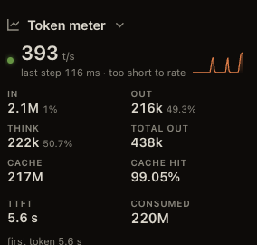
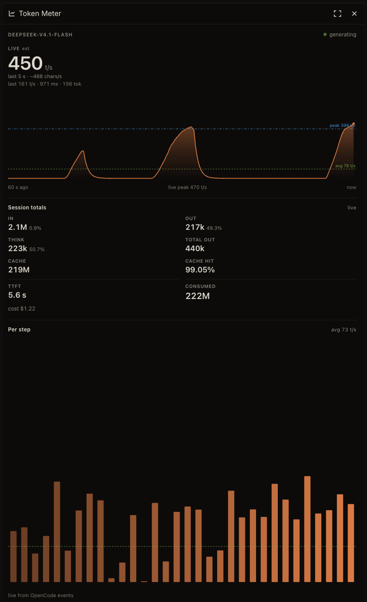

# Token Meter

Live tokens per second for the open OpenChamber session, and what that session
has spent: input, output, thinking, cache hits, time to first token, and the
total consumed. A session's subagents are part of it: while one of them streams,
the headline moves, and their tokens count in the totals.



The chat's Work Status panel keeps the speed beside the conversation.



The rail panel: live speed, running subagents, session totals, cost, and every
kept step with its count and time axis.

## Install

Settings → Extensions → paste this, choose **Add**, allow the two permissions
(a local service, read from OpenCode):

```
https://github.com/omkardamame/openchamber-token-meter.git
```

## What it shows

- **Live `t/s`** — the sum of the session and every streaming subagent, with the
  last finished step underneath.
- **Graph** — the last 60 seconds, with the session's average and best step marked.
- **Subagents** — each subagent still working, its own live rate, and how many
  of the tree are running.
- **Totals** — In, Out, Think, Total out, Cache, Cache hit, TTFT, Consumed.
- **Cost** — the session's total, the last turn, the model, its blended cost
  per million and its actual input, output and cache-hit rates.
- **Per step** — the session's step count and its last 1,000 steps, with a
  start/now time axis, orange for the session and blue for a subagent, the green
  average and the red best step.
- **Work Status** — the same numbers as a compact strip in the chat panel, so
  the speed sits next to the conversation.

## Where the numbers come from

OpenCode's own records: per-step token counts, part timings, and its event
stream. That is provider- and agent-agnostic — any model, any agent.

A task tool runs its subagent in a session of its own. The meter follows those
child sessions (`parentID`), adds their rates to the parent's headline, and
counts their tokens and cost in its totals; the per-step chart marks their
steps. OpenCode keeps each session's own record separate, so summing a tree
cannot count the same step twice.

The headline is a sum, not a pick: every member that is streaming contributes
its own estimated rate, with its own learned ratio. The rail panel lists each
running subagent separately, so the combined number can be read apart.

The last-turn cost starts at the last user message, or at the turn-start event
when the meter is already watching. The model's own $/1M rates are recovered
from OpenCode's per-step costs: each step gives one equation in input, generated
and cache-read tokens, so a least-squares fit returns the provider's real linear
price. It needs a few differently shaped steps; when a tier or a cache-write
charge makes the cost non-linear, the rates are withheld instead of guessed.
The blended effective rate sits beside them.

Totals, per-step speed and TTFT are measured. The live `N t/s` is an estimate:
streamed characters × a ratio learned from finished steps, kept per session so
two models in one tree do not share a ratio.

## Limits

- Web and desktop only — VS Code and mobile do not load extensions.
- Needs OpenChamber 2.7.0 or newer.
- A collapsed Work Status section shows only its title; OpenChamber's extension
  API has no slot for a value there, so leave it expanded.

## Changelog

Every release, with what changed, in [CHANGELOG.md](CHANGELOG.md).

## License

MIT — see [LICENSE](LICENSE). Copyright (c) 2026 Omkar Damame.
